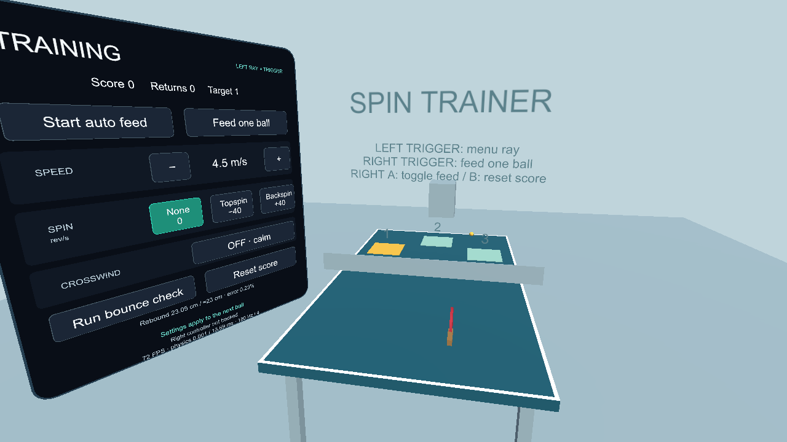
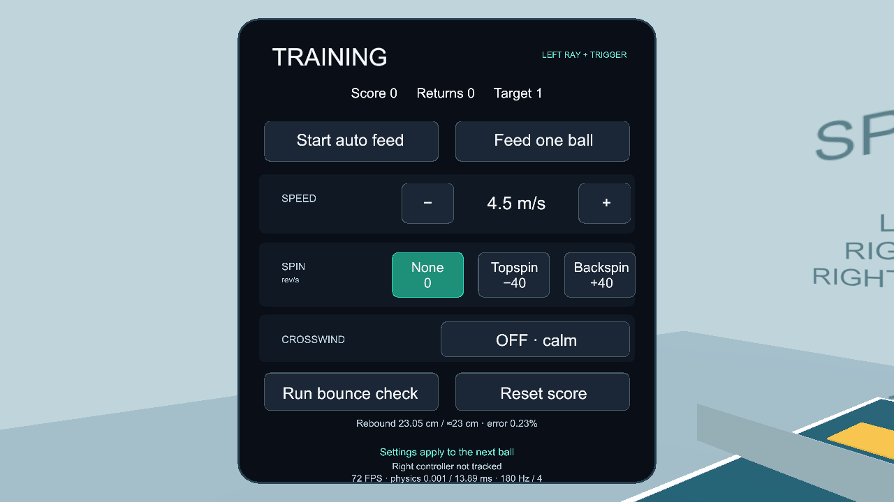

# VR Table Tennis Trainer

A **native Unity / Meta Quest** sports-training prototype. Return machine-fed balls toward target zones while changing speed, spin and crosswind, with a controller-mounted paddle and positional audio.

[Watch the walkthrough](https://youtu.be/xuSDYGRPgAA) · [Download the Quest APK](https://github.com/daniel-aguilar03/vr-table-tennis-trainer/releases/latest) · [Physics references](PARAMETERS.md)



## Highlights

- Adjustable practice-ball feed with no-spin, topspin and backspin presets.
- Gravity, quadratic air drag, bounded Magnus lift and optional crosswind.
- Tracked paddle contact using swing speed, rotation and face orientation.
- Spin-dependent contact friction, restitution, surface bounce and simplified rolling.
- Continuous collision sweeps and smaller substeps for fast paddle/ball motion.
- A left-controller settings panel, spatial impact/approach audio and an in-app bounce check.

## Install on Quest

This is an **Android Quest APK**, not a browser game or WebXR build.

Download `demo2-v1.0.4.apk` from [Releases](https://github.com/daniel-aguilar03/vr-table-tennis-trainer/releases/latest). Use Meta Quest Developer Hub, SideQuest, or an authorized USB-debugging connection:

```sh
adb devices
adb install -r demo2-v1.0.4.apk
adb shell am start -n com.danielaguilar.portfolio.spintrainer/com.unity3d.player.UnityPlayerActivity
```

Developer Mode / USB debugging must be permitted on the headset. Accept its USB-debugging prompt; on a managed device, follow the administrator's deployment policy. Launch from Unknown Sources / the headset's app library. Leave enough physical space to swing and disconnect the cable before playing.

## Controls

| Control | Action |
| --- | --- |
| Right controller | Paddle; no grip button required |
| Right trigger | Feed one ball |
| Right A | Toggle automatic feeds |
| Right B | Reset session score |
| Left-controller ray + trigger | Select settings and actions |

The panel directly selects speed, spin and crosswind. Bounce Check pauses feeds for a controlled measurement—it is not a bounce-strength setting. Reset Score keeps the selected settings. Returns earn 10 points, with 100 points for the highlighted target zone.



## Open and build

Open the repository root as a **Unity 6000.3.22f1** project with Android Build Support, SDK/NDK and OpenJDK installed. Packages and project settings are included; generated Library, Logs and build folders are not.

1. Open `Assets/Scenes/Trainer.unity`.
2. Use **Portfolio → Prepare Trainer** to configure the runtime-built scene and OpenXR settings.
3. Use **Portfolio → Build Quest APK** to generate `Builds/demo2-v1.0.4.apk`.

The existing editor tool menu retains its original name. The build uses ARM64, IL2CPP, OpenXR, Meta Quest Support, Oculus Touch controllers and UnityPlayerActivity. The included APK is the previously tested v1.0.4 build; this source extraction does not rebuild or alter its binary.

## How it works

- **Launch:** predict the flight and choose an initial upward speed to clear the net and land on the player's half. After launch, normal physics runs without mid-air steering.
- **Flight:** fixed-step, semi-implicit integration at 180 Hz, with four integration/contact substeps per update.
- **Paddle:** tracking provides movement and angular velocity. Contact considers ball motion relative to the moving paddle face, including wrist rotation.
- **Surfaces:** normal restitution controls rebound; tangential friction couples translation and spin. Sweeps detect contacts along movement paths rather than only at endpoints.
- **Audio:** positional mono sources follow the ball or appear at impact locations, with distance attenuation.

## Validation

A 30 cm drop was compared with an approximately 23 cm rebound reference. Numerical and Unity scene checks, launch-preset results and grip validation are retained in [Validation/](Validation/). Physics parameters, sources and approximations are documented in [PARAMETERS.md](PARAMETERS.md).

The original v1.0.4 build was installed on Quest, and the user confirmed the feed crossed the net. This is not proof that every trajectory matches real equipment or a new sustained-performance certification. Detailed historical fixes remain in [release notes](RELEASE_NOTES.md).

## Scope

This is a stationary trainer, not a multiplayer game or professional sports simulator. The aerodynamic model is bounded and approximate; rolling losses and several coefficients are simplified or calibrated design values. The paddle follows the controller rather than reacting dynamically to ball forces.

Created by **Daniel Aguilar**. See [credits and provenance](CREDITS.md).
